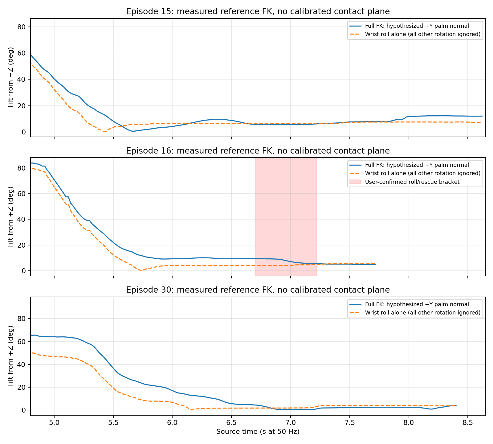

# Palm geometry and ready-return diagnosis

2026-10-09. CPU MuJoCo 3.8.1 **measured-joint forward kinematics and reference trajectories**, not a trained VLA rollout or physical simulation acceptance. No robot commands, GPU rendering, source-data edits, or production edits were performed.

**Finding:** the failed episode is consistent with an inclined support plane during finger opening, but wrist roll alone understates that inclination. The recordings cannot establish a calibrated palm angle, contact stability threshold, or cause from angle alone. A separate native ready-return joint-order defect was reproduced and must be fixed before ready-return acceptance.

Follow-up: the main agent corrected that indexing. The rerun
[native mapping probe](native-ready-mapping-check.json) reports zero target
mapping error and preserved non-right-arm targets. The saved pre-fix probe
remains the reproduction. This correction does not establish physical settling
or clearance; see the [current acceptance report](../README.md).

## Reproducibility and coordinates

Run `extract.py` with `/home/jihun/work/Isaac-GR00T/.venv/bin/python`; run `diagnose.py` and `check_native_ready.py` with `/home/jihun/work/VoLoAgent/.worktrees/g1-harness-native/.venv/bin/python`. Set `PYTHONDONTWRITEBYTECODE=1` for the native import probe. Only local libraries and source files are used.

[source-hashes.json](source-hashes.json) records all three source parquets/videos, metadata, the native XML and all its mesh files, candidate target, and controller sources. [evidence.json](evidence.json) records exact zero-based source frames, joint values, transformations, joint-address mapping and reference paths. [measured-extract.npz](measured-extract.npz) contains the 1,240 source rows used. Frame indices equal row indices; timestamps in the report are frame/50 seconds.

Metadata order is legs 0–11, waist 12–14, left arm 15–21, left hand 22–28, right arm 29–35, right hand 36–42. Every measured joint is assigned using `model.joint(name).qposadr`, including the hands; neither dataset order nor XML qpos order is assumed to be motor order. Motor feedback uses a separate name mapping for the 29 body joints in the native probe.

The named `base_qw/qx/qy/qz` root quaternion is normalized and applied as world-from-pelvis. World gravity is −Z. Its implied pelvis-frame gravity agrees with the recorded projected gravity within **0.000002°** across all rows, establishing internal orientation consistency. Root translation is absent and is fixed at zero. Positions therefore use world-oriented axes relative to the pelvis origin; they are not desk-clearance measurements. Camera calibration and end-effector quaternion semantics are not inferred or used.

## Palm-plane hypothesis and comparison

The XML attaches the palm mesh to `right_wrist_yaw_link` with identity rotation and offset `[0.0415, −0.003, 0]` m. Its raw mesh extent is approximately `[110.2, 48.6, 86.0]` mm; the smallest covariance axis lies about 3.4° from Y. Index/middle bases span Z, fingers extend +X and positive finger flexion about +Z curls them toward +Y. This supports **+Y as a candidate palm-facing normal and XZ as a candidate support plane**. The mesh's thickness, curvature, pads and real contact region mean this is not a fitted or calibrated bottle-contact plane. Reverse-sign normal results and unsigned plane inclination are also recorded.

The full calculation includes root orientation, waist, shoulder, elbow and all wrist rotations. The roll-only comparison assumes every other rotation is identity: `acos(sin(right_wrist_roll))`. These are diagnostics under the stated normal hypothesis, not calibrated physical tilt measurements.

| Episode / source frame | Visual sample context | Full FK candidate tilt | Roll-only tilt |
|---|---|---:|---:|
| 15 / 350 | Fingers opening under bottle | 5.72° | 6.21° |
| 15 / 365 | Open-hand offer | 6.55° | 6.35° |
| 15 / 375 | Offer before human removal | 7.64° | 7.41° |
| 16 / 320 | Finger opening underway | 9.42° | 3.85° |
| 16 / 335 | Start of supplied roll/rescue bracket | 9.62° | 4.01° |
| 16 / 345 | Bottle rolling; fingers near open | 8.95° | 4.05° |
| 16 / 350 | Bottle has moved off hand | 7.08° | 4.12° |
| 30 / 370 | Open-hand offer | 2.08° | 4.06° |
| 30 / 390 | Offer before removal | 2.58° | 3.99° |

Episode 16's index distal joint falls from 0.927 rad at frame 320 to 0.090 at 335 and −0.007 at 345. The bottle rolls during this release interval while the candidate plane remains inclined. Later improvement of the angle cannot undo the lost support. Episode 15 also reaches 8.72° at frame 325 while its fingers remain curled; angle alone cannot classify success. The ready-pose sample is about 12° under this convention and should not be used as a bottle-support target.

Ranked, testable explanations for future scene validation:

1. Full-arm support-plane inclination plus finger release drives rolling. At a matched bottle pose/opening trajectory, leveling the calibrated support surface should reduce displacement.
2. Bottle placement relative to the palm/fingers and its rolling axis determines whether a similar inclination is tolerated. Matched inclinations with different placement should produce different stability.
3. Release/contact transients or arm acceleration impart motion. With the same final pose, a slower matched release/hold should change displacement. Recorded geometry alone cannot separate these effects from rolling friction, bottle deformation or human contact.

## Ready-return limits and defect

All 14 candidate named arm/hand targets are inside the XML joint limits. Intended per-joint reference motion at 0.5 rad/s, keeping root/waist/other arm fixed, gives the following **ideal tracking references**:

| Entry sample | Max joint change | Reference time + 0.5 s dwell | Wrist-origin excursion |
|---|---:|---:|---:|
| 15 / 415, visibly empty | 0.00890 rad | 0.518 s | 0.12 mm |
| 16 / 386, human rescue context | 0.22943 rad | 0.959 s | 13.94 mm |
| 30 / 420, removal still occurring | 0.31314 rad | 1.126 s | 71.63 mm |

The last two rows are hypothetical geometry stress cases, **not permission to return while the person/bottle is present**. Excursion is the wrist origin, not the swept hand/forearm volume. Episode 15's target interval contains 17 samples (0.34 s of samples, 0.32 s first-to-last), so it does not itself demonstrate the required 0.5-second settling dwell. The same right-arm target has different gravity orientation when waist/root differ: these three references end at about 11.96°, 11.28° and 16.83° respectively.

The pre-fix native source SHA256 `c555364987de59ee765357bcac1cf0a1457ad89d0ad3e390c9737f885cc2e259` uses an interleaved upper-body planner vector but assigns ready targets to slice `[10:17]`. Actual right-arm planner indices are **[4, 6, 8, 10, 12, 14, 16]**. The [preserved pre-fix probe](native-ready-mapping-check.before.json) shows a **1.79741 rad maximum target error** and changes to left wrist joints. Right wrist roll receives shoulder yaw (0.302757 instead of 1.701305 rad); right wrist pitch receives wrist roll (1.701305 instead of −0.096102 rad), even exceeding the XML pitch limit 1.61443. Bounds and tracking trim must use the corrected indexing too. The main agent was notified; [the rerunnable check](check_native_ready.py) deliberately makes no controller connection.

## Remaining acceptance work

After the native mapping fix, validate actual named output joints, unchanged waist/left arm/hands as intended, 0.5 rad/s rate, 0.15 rad measured lead, invalid-feedback hold, 0.05 rad tolerance, continuous 0.5 s settling, and 15 s deadline through the existing native tests and SONIC tracking. Ideal reference paths here do not establish that behavior.

Physical validation additionally needs the actual palm contact-surface transform, bottle shape/COM/fill and friction/rolling properties, initial bottle contact pose, gravity/encoder alignment, desk pose/dimensions and person clearance. Measure hand/forearm swept volume and bottle stability in that scene; a small joint change or upright-looking camera image is insufficient. Positive/negative episode comparisons should retain finger release and whole-arm motion, not gate on wrist roll alone. No fixed real desk clearance or stable-offer threshold is claimed here.
