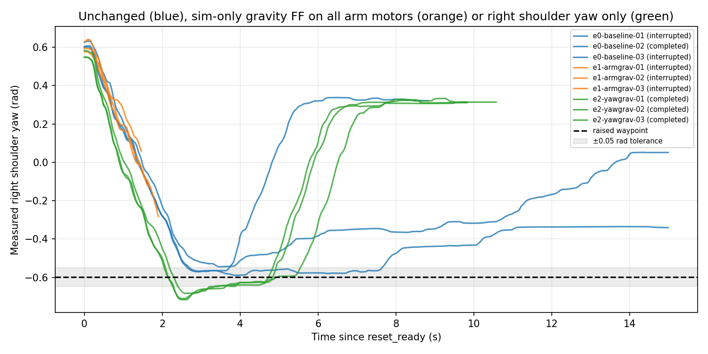

# Ready-return stall: delivered PD and gravity comparison, 14 October 2026

Follows the [tracking handoff](../g1_handover_20261014_tracking/HANDOFF.md).
**Diagnosis:** the raised waypoint's right-shoulder-yaw gravity load needs
about as much PD error as the 0.15 rad reference lead allows. SONIC supplies
almost no learned offset on that joint. Once the initial swing misses the
dwell, delivered torque roughly equals the gravity load. The arm then stalls
or creeps back, and `StandingReset` retracts the reference behind it.
**No production fix was made.** Each available fix changes a pose, a limit or
the deployment torque model. Those choices need review.

No hardware ran. All nine trials used the unchanged native commit `5deabf4`
and binary `c0058137…`. The probe was the handoff's loopback probe with grounded
physics, zero-speed planner packets and no VLA actions, plus a sim-side
recorder. Every trial stopped all owned processes.



## 1. Encoder input (handoff step 1)

The handoff's step 1 is settled from code and saved data, without new C++ logging:

- SONIC runs encoder mode 0 (`g1`). `GatherMotionJointPositionsMultiFrame`
  overwrites the 17 upper-body joints in all 10 future frames of
  `motion_joint_positions_10frame_step5` with `upper_body_joint_positions_buffer_`,
  and it does the same for velocities while playing
  (`g1_deploy_onnx_ref.cpp:793`, `:870`). `ZMQManager` sets
  `has_upper_body_data_` whenever a planner message carries `upper_body_position`.
- The ordering is consistent. Python's `G1_UPPER_BODY_JOINT_INDICES` equals
  `upper_body_joint_isaaclab_order_in_mujoco_index`, and the overlay's
  IsaacLab indices map back to the same motors through `isaaclab_to_mujoco`.
- The decoder follows the overlay rather than the planner motion. In
  `decoder-trace`, `body_q_target[24]` stays at +0.659 for the whole trial,
  while the decoded action follows the bounded reference down to −0.41.

## 2. Delivered command and applied torque (handoff step 2)

[`sim_torque_worker.py`](sim_torque_worker.py) wraps the simulator's
`compute_body_torques`/`sim_step` and records data at 100 Hz:

- the delivered `q`, `dq`, `kp`, `kd` and `tau`;
- the measured `q`/`dq`;
- the PD torque, before and after clipping, and `actuator_force`;
- the frictionloss constraint force;
- the model's static gravity torque.

What the records show:

- The delivered command equals telemetry `last_action` (within ~0.015 rad
  across the window). `kp`=14.2506 and `kd`=0.9072 on motor 24 match native
  `kps`/`kds`. The controller's `tau` and `dq` are always 0. No clipping
  occurs during any reset, and `actuator_force` equals the clipped torque.
- The robot model is not the cause. The trial scene's robot has zero
  differences from the stock `scene_43dof.xml` in masses, damping, armature
  and frictionloss. Arm subtree masses match SONIC's training URDF: 2.685 kg
  below the right shoulder yaw. The only sim extra is 0.2 Nm frictionloss,
  which equals 0.014 rad at Kp.
- At the raised waypoint, static gravity divided by Kp gives these sags:

  | Joint | Sag (rad) |
  | --- | ---: |
  | Shoulder pitch | 0.133 |
  | Shoulder roll | 0.398 |
  | Shoulder yaw | 0.146 |
  | Elbow | 0.185 |

  SONIC learned to offset roll: its action is about 0.37 rad past the
  reference. It offsets yaw by only about 0.01–0.03 rad. Yaw therefore needs
  ≈0.146 + 0.014 rad of reference lead, which is the whole 0.15 rad budget.
- Baseline torque balance on yaw (last 2 s, timed-out trials):
  - Run 01: applied −2.38 Nm against a gravity hold of −2.34 Nm.
  - Run 03: applied −2.15 Nm against −2.26 Nm, and the joint drifted back at
    +0.068 rad/s.

  A second blocker also appears. In `e0-baseline-01`, yaw sat in tolerance,
  but the preserved left shoulder yaw/elbow (motors 17/18) were 0.05–0.09 rad
  off, so the dwell never accumulated.

## 3. Controlled comparison (handoff step 3)

Only the physics-side feedforward changes between conditions: the model's
static gravity torque, added in simulation only. Conditions were interleaved
in time. The 0.15 lead, 0.5 rad/s rate, 0.05 rad tolerance, 0.5 s dwells and
15 s deadline are unchanged.

| Condition | Completed |
| --- | ---: |
| E0 unchanged physics | **1 / 3** |
| E1 gravity FF on all 14 arm motors | **0 / 3** |
| E2 gravity FF on right shoulder yaw (motor 24) only | **3 / 3** |

Columns: stage-1 entry (s), maximum raise dwell (s), maximum 31-joint
reference lead (rad), then right-shoulder-yaw values over the reset's last
2 s: command − measured (rad), applied torque (Nm), gravity hold (Nm) and
velocity (rad/s). Completed trials end that window in the final ready pose,
not at the raised waypoint.

| Trial | Terminal | Stage 1 | Dwell | Lead | Gap | Applied | Gravity | dq |
| --- | --- | ---: | ---: | ---: | ---: | ---: | ---: | ---: |
| `e0-baseline-01` | INTERRUPTED/reset_timeout | — | 0.38 | 0.150 | −0.168 | −2.38 | −2.34 | −0.002 |
| `e0-baseline-02` | COMPLETED | 3.55 | 0.50 | 0.150 | −0.030 | −0.42 | −0.40 | −0.006 |
| `e0-baseline-03` | INTERRUPTED/reset_timeout | — | 0.00 | 0.150 | −0.146 | −2.15 | −2.26 | +0.068 |
| `e1-armgrav-01` | INTERRUPTED/reset_reference_lead_exceeded | — | 0.00 | 0.150 | −0.016 | −1.41 | −1.47 | −0.297 |
| `e1-armgrav-02` | INTERRUPTED/reset_reference_lead_exceeded | — | 0.00 | 0.150 | −0.032 | −1.59 | −1.47 | −0.361 |
| `e1-armgrav-03` | INTERRUPTED/reset_reference_lead_exceeded | — | 0.00 | 0.150 | −0.044 | −2.03 | −1.82 | −0.448 |
| `e2-yawgrav-01` | COMPLETED | 4.57 | 0.50 | 0.150 | +0.002 | −0.28 | −0.31 | +0.004 |
| `e2-yawgrav-02` | COMPLETED | 4.57 | 0.50 | 0.150 | −0.002 | −0.41 | −0.39 | −0.002 |
| `e2-yawgrav-03` | COMPLETED | 5.28 | 0.50 | 0.150 | +0.001 | −0.35 | −0.37 | −0.003 |

- **E0:** the one success reached the waypoint during the first swing
  (~3.5 s), as the original `paired-baseline` did. The failures miss during
  the swing and then cannot recover under the lead bound.
- **E1** rejects "add gravity compensation everywhere". SONIC's learned roll
  offset stacks on the feedforward. Roll overshoots to −1.01 rad against a
  −0.68 target and runs away from the reference faster than the retraction
  rate. The lead guard then interrupts correctly, at about 1.5 s.
- **E2** supports the diagnosis. Supplying only the missing yaw gravity torque
  lets all three trials settle at the waypoint, open the hand and pass final
  settling.

E2 changes the physics the policy sees. It is evidence for the cause, not a
deployment model.

## Open decisions before any production change

1. **Waypoint pose.** Choose a raised pose whose shoulder-yaw gravity load is
   well inside the lead budget, then re-review its desk clearance. The ready
   pose's yaw load is only 0.019 rad. Lowest risk; needs a pose review.
2. **Real-robot feedforward.** Send yaw gravity torque through `tau` on
   hardware. This changes the torque model SONIC was trained with and is
   unvalidated on hardware.
3. **Lead-bound semantics.** Allow a larger lead on gravity-loaded joints.
   This changes an existing acceptance limit.

The preserved-left-arm sag (motors 17/18) can still block the dwell on its own.
Any fix must be repeat-tested for that.

Still open, unchanged from the handoff:

- actual post-handover entry poses;
- swept desk/person clearance;
- the full connected VLA cycle;
- supervised hardware acceptance.

The real robot's actual friction and sag were not measured here.

## Reproduce

From the VoLoAgent worktree, with GPU 1 checked for 2 GiB free and loopback
ports free:

```bash
env PYTHONPATH=. .venv/bin/python docs/artifacts/g1_handover_20261014_torque_probe/run_torque_probe.py --gpu 1 --desk-front-m 0.40 [--gravity-ff-motors 24] --output /tmp/new-dir
/home/jihun/work/VoLoAgent/.worktrees/g1-harness-native/.venv/bin/python docs/artifacts/g1_handover_20261014_torque_probe/analyze.py
```

`trials/` holds every run's `result.json`, as-run worker sources, profile,
scene and logs. Its JSONL streams are gzip-compressed. A run that does not
complete exits with status 1 by design.
